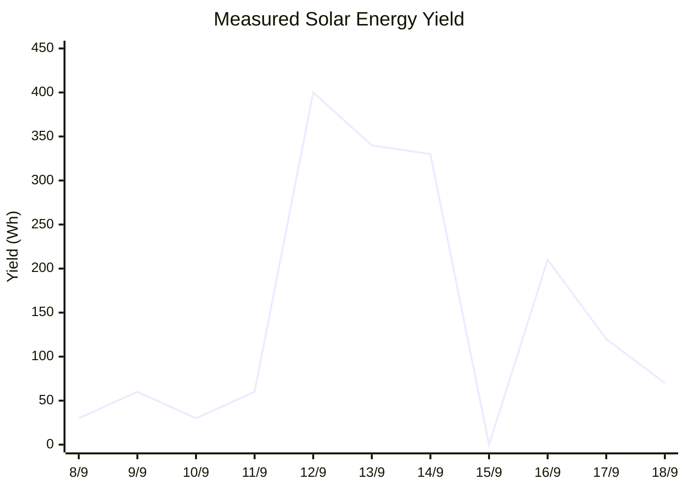
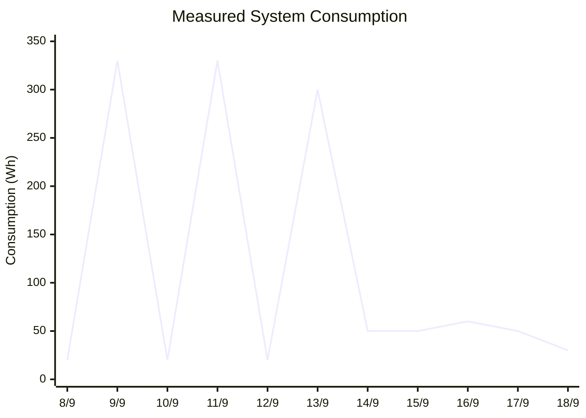
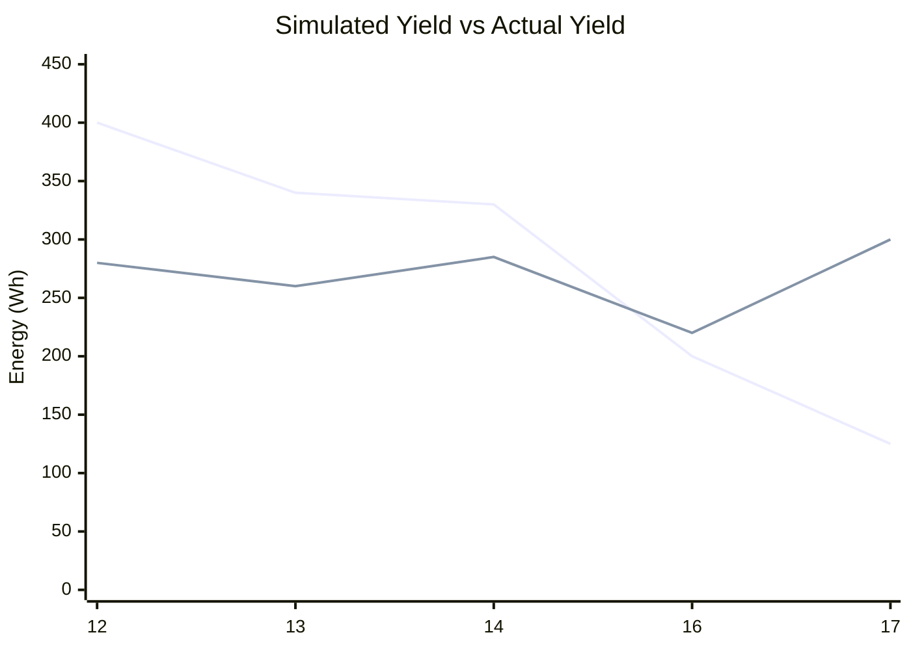
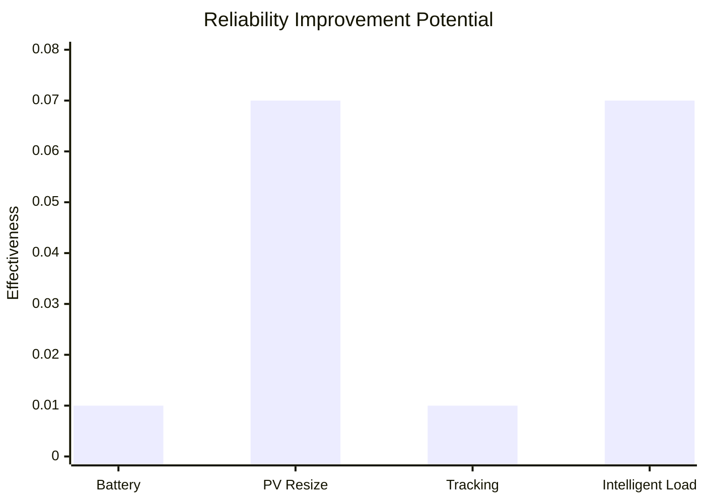
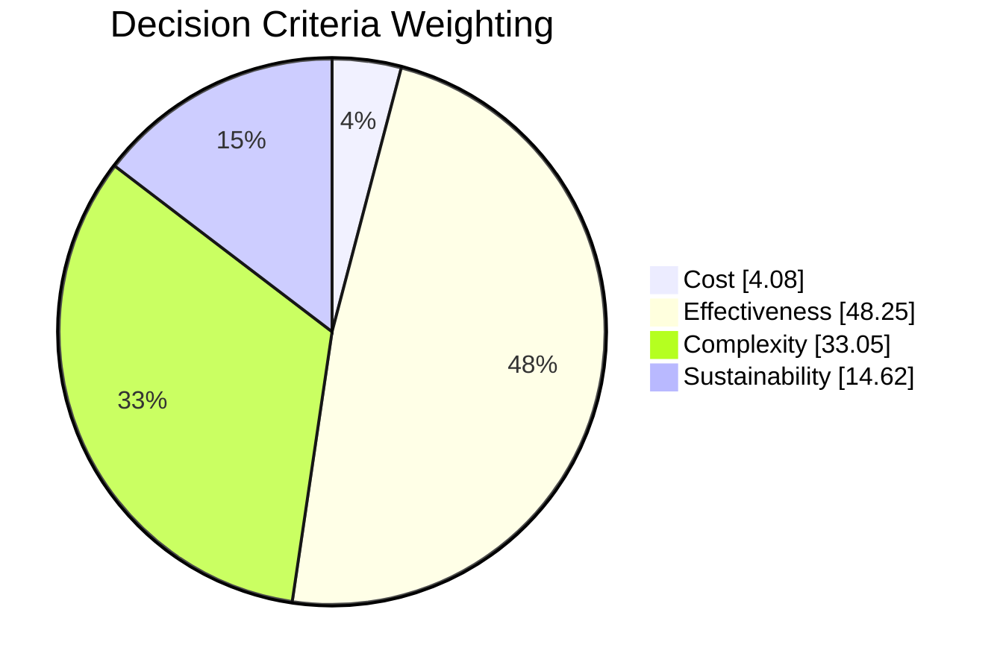
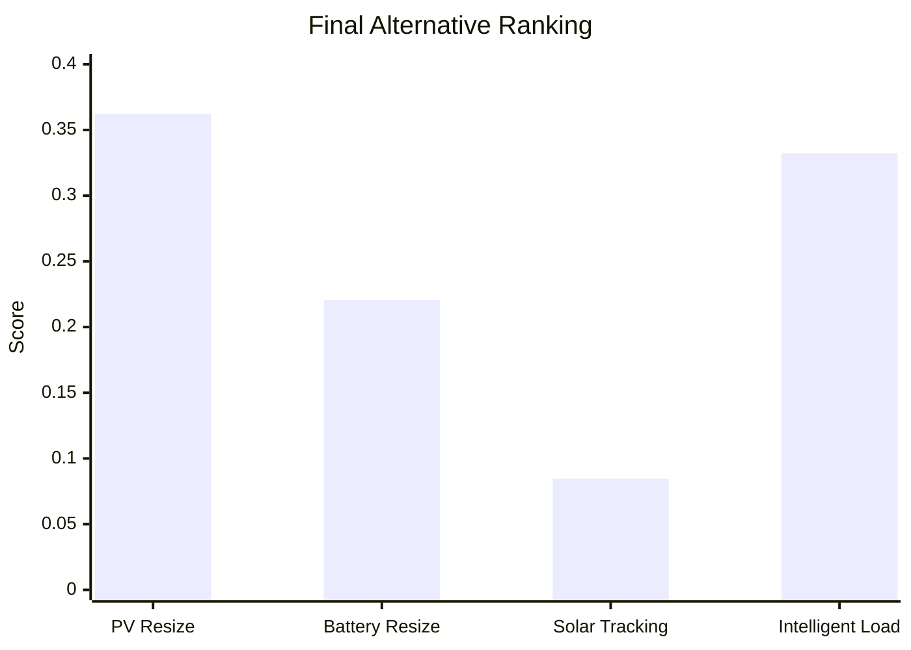

# Solar Lighting Reliability Study

## Project Overview

Many solar-powered street lights and variable message signs (VMS) experience reliability issues during winter due to reduced solar irradiance and shorter daylight hours. These failures can have safety implications in regional areas where off-grid solar infrastructure is often the only practical solution.

This project investigated practical methods to improve the wintertime reliability of standalone solar-powered lighting and signage systems through a combination of:

- Real-world system testing
- PV system modelling
- Data analysis and calibration
- Sensitivity analysis
- Multi-criteria engineering decision making

The project was completed in collaboration with **LoveJoy Services** and focused on identifying the most effective and practical design improvements for solar-powered road infrastructure. 

---

# My Contributions

- Developed a predictive energy-yield model for a standalone solar PV system.
- Collected and analysed real-world performance data from a Victron-based test installation.
- Calibrated model outputs against field measurements using RMSE minimisation.
- Performed sensitivity analysis on multiple system modification strategies.
- Applied the Analytical Hierarchy Process (AHP) to rank design alternatives.
- Produced engineering recommendations grounded in quantitative analysis.
- Prepared technical documentation and stakeholder deliverables. 

---

# Engineering Problem

The project investigated how to improve the winter performance of solar-powered street lights and VMS systems.

Research showed:

- Fatal crash risk can increase by up to **3× at night**.
- Pedestrian fatality risk may be up to **7× higher at night**.
- Road lighting has been shown to reduce fatal and injury crashes by up to **60%**. 

The challenge was therefore not simply improving energy generation, but improving the reliability of safety-critical infrastructure. 

---

# System Architecture

## Test System

The experimental setup included:

- Victron BlueSolar 175 W PV panel
- Victron SmartSolar MPPT 100/20
- 75 Ah lithium battery
- Load bank for overnight discharge
- Irradiance monitoring
- Victron Cerbo GX data collection hardware

The system was monitored over an 11-day testing period and compared against a theoretical PV performance model. 

---

# Field Data Collection

## Measured Energy Yield vs Consumption

The system recorded significant variations in solar yield throughout the testing period.

### Solar Energy Yield

### System Energy Consumption

Key observations:

- Lowest measured yield: **0 Wh**
- Highest measured yield: **400 Wh**
- Significant variability occurred despite relatively consistent solar exposure values.
- Real-world performance was substantially lower than theoretical predictions. 

---

# Predictive Model Development

A mathematical model was developed incorporating:

- PV module efficiency
- Temperature effects
- MPPT efficiency
- Battery efficiencies
- Environmental losses
- Solar irradiance data from the Bureau of Meteorology

The model estimated solar energy generation, battery state-of-charge, and system reliability. 

## Calibration Results

Model calibration was performed using Root Mean Square Error (RMSE).

The optimal calibration factor occurred at:

- **k = 55%**
- Minimum RMSE ≈ **100 Wh** 

Following calibration, the model achieved approximately **70% predictive accuracy** when compared with measured field data.

## Calibrated Model vs Measured Performance

The predictive model was calibrated using a factor of **k = 55%** to minimise RMSE. The chart below compares calibrated model predictions against measured field data.

The calibrated model successfully captured overall system behaviour and achieved approximately **70% predictive accuracy**, providing a practical tool for evaluating future design modifications and reliability improvements before physical deployment.

---

# Design Alternatives Investigated

Four improvement strategies were evaluated:

1. PV Array Resizing
2. Battery Capacity Resizing
3. Solar Tracking
4. Intelligent Load Management

Sensitivity analysis was used to measure the contribution of each alteration to improving reliability. 

## Improvement Effectiveness

Results showed:

- PV resizing and intelligent load management produced the largest improvements.
- Battery resizing had minimal impact.
- Solar tracking produced only a modest improvement despite increased complexity. 

---

# Engineering Decision Analysis (AHP)

The Analytical Hierarchy Process was used to evaluate solutions using four criteria:

- Cost
- Effectiveness
- Complexity
- Sustainability

## Criteria Weighting

Effectiveness and complexity were identified as the most important factors influencing the final recommendation. 

---

# Final Ranking of Solutions

The weighted decision analysis produced the following results:

| Rank | Alternative |
|--------|-------------|
| 1 | PV Array Resizing |
| 2 | Intelligent Load Management |
| 3 | Battery Capacity Resizing |
| 4 | Solar Tracking |

PV array resizing achieved the highest score because it combined strong performance improvements with low implementation complexity. 

---

# Key Findings

Major outcomes included:

- Development of a calibrated PV performance model.
- Successful validation using real-world MPPT data.
- Identification of PV array sizing as the most practical improvement.
- Demonstration that system reliability can be significantly improved without introducing complex mechanical systems. 

---

# Technologies & Methods

### Engineering

- Solar PV System Design
- Reliability Engineering
- Energy Systems Modelling
- Sensitivity Analysis
- Analytical Hierarchy Process (AHP)
- Systems Engineering

### Software & Tools

- Microsoft Excel
- Excel Solver
- VictronConnect
- Victron Cerbo GX
- SmartSolar MPPT Data Logging

### Professional Skills

- Technical Report Writing
- Stakeholder Engagement
- Engineering Research
- Data Analysis
- Technical Decision Making

---

# Lessons Learned

This project provided practical experience bridging theoretical modelling and real-world engineering systems. Calibrating a predictive model using field data highlighted the importance of validation, uncertainty analysis, and engineering judgement when developing solutions for safety-critical infrastructure.

The work reinforced that the technically best solution is not always the optimal solution. Through structured decision analysis, a simpler and lower-risk design modification (PV resizing) outperformed more complex alternatives such as solar tracking, despite similar performance benefits. 