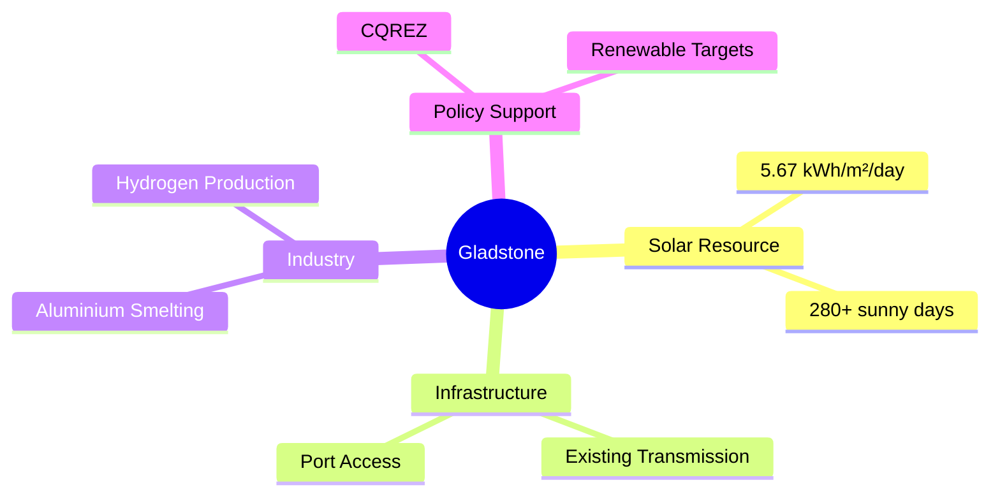
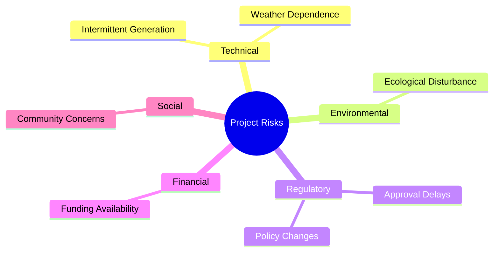

# Gladstone Solar Farm Feasibility Study

## Project Overview

This project investigated the feasibility of developing a utility-scale solar farm in the Gladstone region to support Queensland's renewable energy transition and reduce the environmental impact of energy-intensive industry.

The study focused on offsetting electricity demand at **Boyne Smelters Limited (BSL)**, Australia's largest aluminium smelter, by leveraging Gladstone's strong solar resource, industrial infrastructure, and position within the **Central Queensland Renewable Energy Zone (CQREZ)**. 

The assessment considered:

- Solar resource availability
- Industrial energy demand
- Site suitability
- Land requirements
- Government policy and incentives
- Technical feasibility
- Economic and environmental impacts

---

# Completed

- Researched renewable energy technologies and utility-scale solar developments.
- Evaluated regional solar resource availability using industry data sources.
- Performed energy generation and land-use calculations.
- Assessed policy, regulatory, environmental, and social considerations.
- Quantified industrial power demand and solar farm sizing requirements.
- Developed engineering recommendations and strategic implementation pathways.
- Produced a professional feasibility report for a real-world industrial application. 

---

# Engineering Challenge

Gladstone is one of Australia's most energy-intensive industrial regions and hosts:

- Aluminium smelting
- Hydrogen production
- Heavy industry
- Port operations

A major contributor is **Boyne Smelters Limited (BSL)**, which consumes approximately:

**1,050 MW continuous demand**

representing nearly:

**15% of Queensland's electricity consumption**. 

The challenge was to evaluate whether large-scale solar generation could meaningfully offset this demand while remaining technically and economically practical. 

---

# Why Gladstone?

Several factors make Gladstone highly suitable for solar generation:

- Average solar irradiance of **5.67 kWh/m²/day**
- More than **280 sunny days per year**
- Flat terrain suitable for utility-scale deployment
- Existing transmission infrastructure
- Location within the **Central Queensland Renewable Energy Zone (CQREZ)**
- Access to industrial electricity demand
- Existing renewable energy developments, including **Aldoga Solar Farm** and **Eurimbula Solar Farm**. 

## Site Advantages



---

# Industrial Energy Demand

BSL's electricity demand was used as the primary reference load.

## Annual Energy Consumption

The report calculated annual energy demand using:

$$
1,050 \text{ MW} \times 24 \times 365
$$

Result:

$$
9,198,000 \quad \text{MWh/year}
$$

---

# Solar Resource Assessment

The region's solar resource was evaluated using irradiance data.

| Metric | Value |
|----------|---------:|
| Average Irradiance | 5.67 kWh/m²/day |
| Seasonal Minimum | 4.56 kWh/day per kW |
| Seasonal Maximum | 7.43 kWh/day per kW |
| Sunny Days | 280+ days/year |

The data confirms that Gladstone provides one of Queensland's strongest locations for solar generation. 

---

# Solar Farm Sizing Analysis

Using average solar irradiance and a performance ratio of approximately 75%, the report estimated that:

### Generation from 1 MW Installed Solar

```text
5.67 × 365 × 0.75
≈ 1,556 MWh/year
```

Result:

**1 MW solar ≈ 1,556 MWh/year** 

### Capacity Required to Meet BSL Demand

```text
9,198,000 ÷ 1,556
≈ 5,913 MW
```

Result:

**≈ 5.9 GW of installed solar capacity required** 

This analysis demonstrated that fully supplying BSL using solar alone would be impractical without storage, grid support, or supplementary energy sources. 

---

# Land Use Assessment

The report estimated land requirements using industry-standard utility-scale solar density assumptions.

### Land Requirement Calculation

```text
5,913 MW × 1.75 ha/MW
≈ 10,348 ha
```

Equivalent to:

**103 km² of land**.

The required footprint was found to be comparable to the size of a small regional town. 

---

# Risk Assessment

The study identified several project risks.



Key challenges include:

- Variable solar generation.
- Environmental approvals.
- Community acceptance.
- Access to project funding.
- Policy and regulatory changes. 

---

# Policy & Funding Environment

The project benefits from a supportive policy framework including:

- Queensland's **70% renewable energy target by 2032**
- **Large-scale Generation Certificates (LGCs)**
- **ARENA** funding programs
- **CEFC** low-interest financing
- Renewable energy investment within the **Central Queensland Renewable Energy Zone (CQREZ)**. 


---

# Key Findings

Major findings:

- Gladstone possesses excellent solar resources.
- Existing infrastructure supports renewable development.
- Utility-scale solar is technically feasible.
- Full replacement of BSL demand with solar alone is impractical.
- Solar can significantly offset industrial emissions when combined with batteries, PPAs, or other energy sources.
- Government incentives improve project viability. 

---

# Recommendations

The report recommended:

1. Develop a utility-scale solar farm near Calliope.
2. Offset a portion of BSL's energy demand rather than attempt complete replacement.
3. Investigate battery energy storage systems (BESS).
4. Explore pumped hydro integration.
5. Pursue ARENA and CEFC funding opportunities.
6. Conduct detailed environmental and social impact studies.
7. Develop community benefit agreements.
8. Incorporate sustainability objectives throughout the project lifecycle. 

---

# Technologies & Skills Demonstrated

### Engineering

- Renewable Energy Engineering
- Solar PV System Analysis
- Energy Demand Forecasting
- Utility-Scale Infrastructure Planning
- Feasibility Analysis
- Engineering Economics
- Sustainability Assessment

### Tools

- Microsoft Excel
- Industry Energy Datasets
- Solar Resource Analysis
- Technical Research
- Engineering Reporting

### Professional Skills

- Technical Writing
- Critical Evaluation
- Quantitative Analysis
- Risk Assessment
- Engineering Decision Making
- Strategic Planning

---

# Lessons Learned

This project provided practical experience evaluating a real-world renewable energy opportunity at industrial scale. It highlighted the importance of balancing technical feasibility with land use, economics, policy constraints, and stakeholder considerations.

The analysis demonstrated that large-scale decarbonisation projects require a systems-engineering approach, where renewable generation, storage, transmission infrastructure, and industrial demand must be considered as a single integrated solution rather than independent components. 