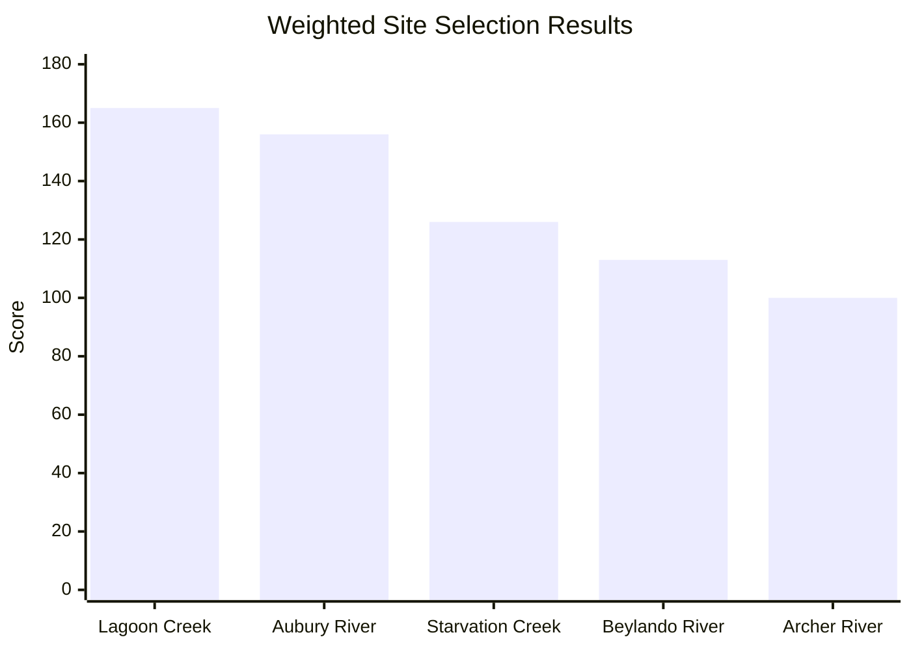
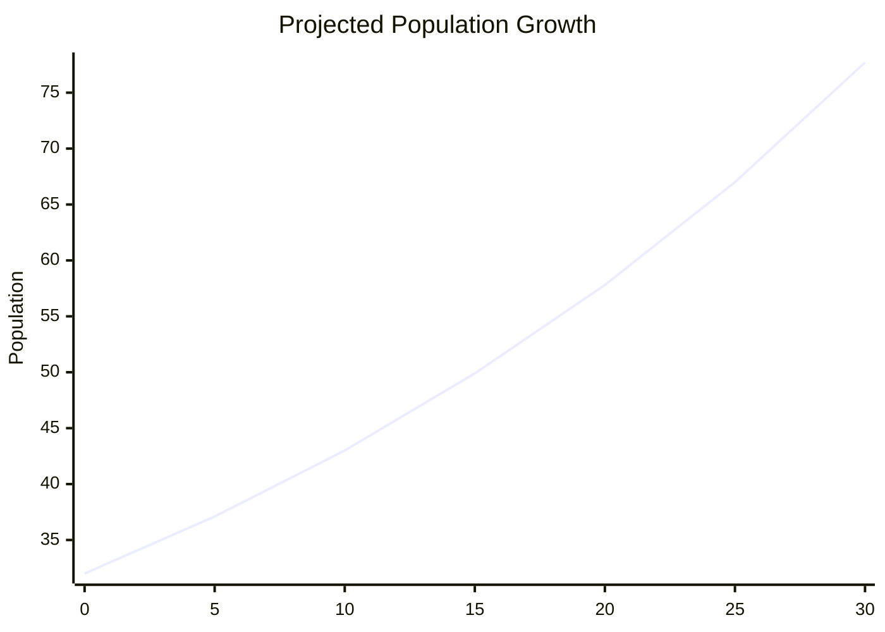

# Lagoon Creek Reservoir Feasibility Study

## Project Overview

This project investigated the feasibility of constructing a large-scale water reservoir on Lagoon Creek near Nicholson, Queensland.

The study combined hydrological analysis, GIS mapping, engineering economics, stakeholder assessment, and conceptual infrastructure design to identify the most suitable reservoir location and evaluate its long-term viability.

### My Contributions

- Performed site selection using weighted multi-criteria decision analysis.
- Analysed streamflow, topographic, and environmental datasets.
- Modelled long-term reservoir performance and water demand.
- Assessed environmental, social, and economic impacts.
- Produced conceptual dam wall designs in AutoCAD.
- Evaluated construction costs and economic benefits.
- Co-authored technical documentation and engineering recommendations.

---

# Key Outcomes

| Metric | Value |
|---------|---------:|
| Selected Site Score | 165 |
| Reservoir Capacity | 56.7 GL |
| Maximum Depth | 27 m |
| Inundation Area | 4.2 km² |
| Dam Height | 30 m |
| Dam Length | 200 m |
| Sustainable Supply | 12 GL/month |
| Estimated Construction Cost | $12.8M - $51.2M |

---

# Site Selection Analysis

Five candidate locations across Queensland were evaluated using a weighted criteria matrix incorporating:

- Topography
- Streamflow
- Land rights
- Environmental sensitivity
- Accessibility
- Community impact
- Future demand

## Final Site Rankings

Lagoon Creek achieved the highest overall score due to its favourable topography, strong streamflow characteristics, low community impact, and efficient dam geometry.

---

# Conceptual Dam Design

A conceptual gravity dam was developed and assessed using preliminary stability calculations.

## Dam Dimensions

| Parameter | Value |
|-----------|-------:|
| Wall Height | 30 m |
| Water Depth | 27 m |
| Freeboard | 3 m |
| Crest Width | 4 m |
| Base Width | 19 m |
| Wall Length | 200 m |

### Engineering Drawings

#### Plan View

#### Elevation View

#### Section View

---

# Environmental Assessment

Environmental constraints were assessed using GIS and Queensland environmental datasets.

### Key Findings

- No protected environmental areas identified near the proposed site.
- No protected downstream floodplain systems affected.
- One remnant endangered ecosystem identified within the proposed inundation area.
- Overall environmental impact assessed as manageable with mitigation measures.

---

# Economic Assessment

A preliminary cost-benefit assessment was completed to evaluate project viability.

## Construction Cost Estimate

| Item | Value |
|--------|--------:|
| Dam Wall Volume | 25,593.75 m³ |
| Cost Range | $500-$2,000/m³ |
| Total Cost | $12.8M-$51.2M |

The analysis indicated substantial economic potential through improved industrial and agricultural water security.

---

# Water Demand & Reservoir Performance

The nearest population centre, Nicholson, currently has approximately 32 residents. Population growth and water demand were modelled over a 30-year design horizon.

## Population Growth Projection

Water balance modelling using historical climate and streamflow data demonstrated:

- Stable long-term operation.
- Typical storage levels between 50 GL and 90 GL.
- Recovery following extreme drought events.
- Sustainable delivery of 12 GL/month.

---

# Skills Demonstrated

### Engineering

- Water Resources Engineering
- Hydrological Modelling
- Reservoir Planning
- Infrastructure Feasibility Analysis
- Engineering Economics
- Risk Assessment
- Environmental Assessment

### Software

- AutoCAD
- Microsoft Excel
- Google Earth Pro
- Queensland Globe
- GIS Mapping Tools
- Microsoft Word

### Professional Skills

- Technical Report Writing
- Stakeholder Analysis
- Data Analysis
- Decision-Making Frameworks
- Engineering Design Documentation

---

# Lessons Learned

This project provided practical experience in evaluating real-world infrastructure projects that require balancing technical, environmental, economic, and social considerations. It strengthened my ability to work with geospatial data, engineering calculations, design constraints, and multidisciplinary decision-making processes.