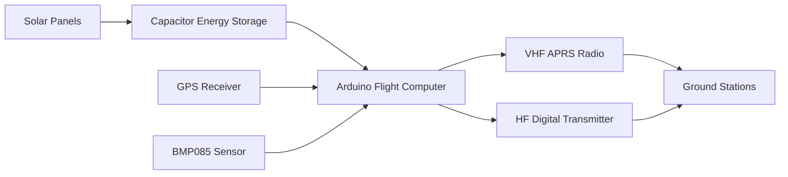
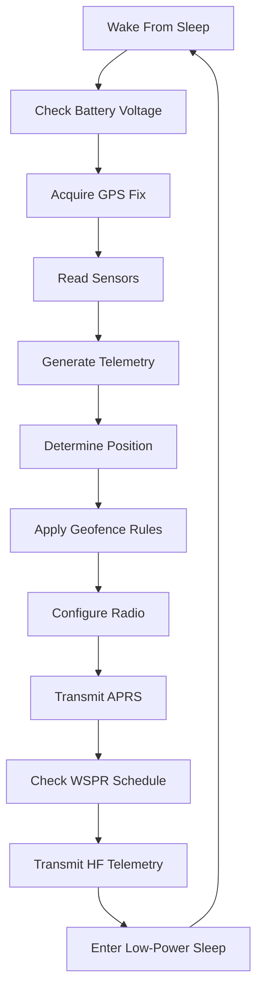
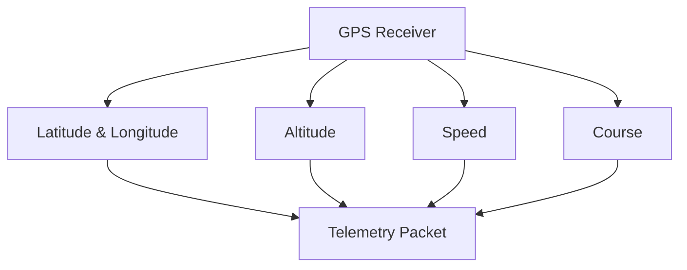
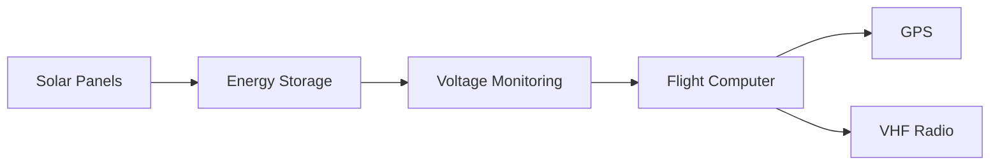
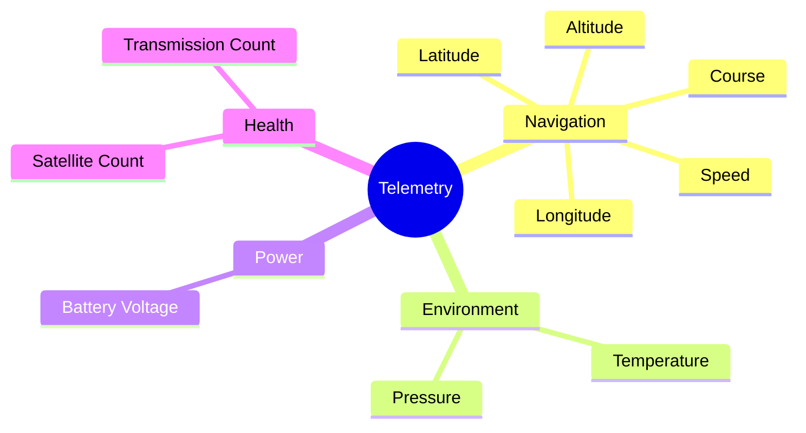

# High-Altitude PICO Balloon Platform

## Project Overview

In collaboration with Coral Coast Rotary, I designed and built a solar-powered high-altitude PICO balloon payload capable of autonomous operation in the stratosphere.

The project combined embedded systems, RF communications, power electronics, and navigation systems to create a lightweight, flight-ready platform capable of transmitting telemetry across thousands of kilometres using VHF APRS networks.

Unlike traditional weather balloons that carry heavier payloads and complete short-duration missions, PICO balloons use ultra-lightweight electronics and solar power to remain airborne for extended periods while continuously transmitting position and status information.

---

# My Contributions

- Designed the flight electronics architecture.
- Sourced all electronic components and flight hardware.
- Assembled and soldered the complete payload.
- Integrated solar panels, capacitors, GPS receiver, pressure sensor, radio hardware, and antennas.
- Adapted and extended the open-source LightAPRS PICO balloon firmware for our mission requirements.
- Implemented and tested GPS-based geofencing and automatic frequency selection.
- Optimised power-management algorithms for solar-only operation.
- Refined APRS telemetry reporting and communications reliability.
- Performed debugging, system integration, validation, and flight preparation.

---

# Engineering Challenge

The platform needed to operate autonomously in an extremely constrained environment:

- Ultra-lightweight payload
- Limited solar energy availability
- Extreme high-altitude temperatures
- No physical access after launch
- International amateur-radio regulations
- Continuous GPS tracking requirements
- Long-duration autonomous operation

The flight computer had to continuously manage power consumption, communications scheduling, environmental data collection, and navigation while maintaining reliable operation.

---

# Open Source Engineering

The project was built upon the open-source LightAPRS PICO balloon platform and several amateur-radio software libraries.

Rather than developing the firmware entirely from scratch, I focused on:

- Hardware integration
- Flight-system configuration
- Mission-specific firmware modifications
- Power optimisation
- GPS configuration
- Communications testing
- Reliability improvements
- System validation

This reflects a common engineering practice where proven open-source systems are adapted, integrated, and validated to meet specific project requirements.

### Open Source Components

- LightAPRS PICO Balloon
- TinyGPS++
- LibAPRS
- JTEncode
- Si5351 Arduino Library
- LowPower Library
- Adafruit BMP085 Library

---

# System Architecture

The payload harvested solar energy, acquired GPS and environmental data, packaged telemetry messages, and transmitted them using VHF APRS communications.

---

# Embedded Software Architecture

Custom firmware was modified and extended in Embedded C using the Arduino platform.

The software operated as an autonomous state machine responsible for:

- Power management
- GPS acquisition
- Environmental telemetry
- APRS tracking
- HF communications
- Geofence compliance
- Radio configuration
- Autonomous recovery
- Sleep-state management

### Key Firmware Features

- Watchdog-based fault recovery
- GPS timeout detection and reset
- High-altitude GPS configuration
- Dynamic power control
- Battery-aware operation
- Automatic radio reconfiguration
- Geographical frequency compliance
- Autonomous subsystem power switching

---

# Communications System

The payload implemented two independent communications systems to maximise tracking coverage.

## VHF APRS Tracking

The primary tracking channel used APRS over amateur-radio VHF frequencies.

Telemetry included:

- GPS position
- Altitude
- Speed
- Course
- Temperature
- Pressure
- Battery voltage
- Satellite count
- Transmission count

---

# Autonomous Frequency Management

One of the most technically challenging elements of the project was implementing autonomous frequency management.

The software used GPS-derived position data to:

- Determine operating location
- Identify regional APRS frequencies
- Configure radio hardware automatically
- Modify APRS routing behaviour
- Disable transmissions where airborne APRS was restricted
- Support optional ISS relay operation

This allowed the payload to operate across multiple communication regions without manual intervention.

---

# GPS & Navigation Systems

The platform used a u-blox GPS receiver configured specifically for high-altitude balloon applications.

### Navigation Features

- High-altitude Dynamic Model 6 operation
- GPS health monitoring
- Automatic receiver recovery
- Maidenhead grid locator generation
- Location-aware radio operation
- Autonomous navigation

The firmware continuously monitored GPS quality and automatically reconfigured or restarted the receiver when required.

---

# Power Management

Power availability was the most significant engineering constraint.

The payload operated from:

- Solar panels
- Capacitor-based energy storage
- Ultra-low-power firmware

### Power Management Features

- GPS power gating
- Radio power gating
- Adaptive transmit power
- Battery voltage supervision
- Dynamic sleep scheduling
- Watchdog-based recovery

The system continuously adjusted behaviour based on available energy, helping maximise operational lifetime during periods of low solar generation.

---

# Telemetry System

Environmental and flight data were packaged into APRS telemetry messages and transmitted throughout the mission.

| Parameter | Source |
|------------|----------|
| Latitude & Longitude | GPS |
| Altitude | GPS |
| Speed | GPS |
| Course | GPS |
| Temperature | BMP085 |
| Pressure | BMP085 |
| Battery Voltage | ADC Monitoring |
| Satellite Count | GPS |
| Transmission Count | Flight Software |

---

# Key Outcomes

### Deliverables

- Fully assembled flight electronics platform.
- Customised embedded flight software.
- Autonomous GPS tracking capability.
- Geofence-aware radio communications.
- Environmental telemetry collection.
- Multi-channel radio communications.
- Solar-powered autonomous operation.
- Flight-ready high-altitude balloon payload.

---

# Technologies & Skills Demonstrated

## Embedded Systems

- Embedded C
- Arduino Development
- State-Machine Design
- Real-Time Systems
- Watchdog Recovery
- Low-Power Firmware Optimisation

## Communications Engineering

- APRS
- VHF Communications
- Amateur Radio
- RF Telemetry Systems

## Aerospace & Navigation

- High-Altitude Systems
- GPS Integration
- Geofencing
- Autonomous Navigation
- Telemetry Engineering
- Environmental Sensing

## Electronics

- Soldering
- Electronics Prototyping
- Sensor Integration
- Antenna Construction
- Solar Power Systems
- Embedded Hardware Assembly

---

# Lessons Learned

This project provided practical experience building a complete autonomous aerospace telemetry platform from concept through flight readiness.

The work required integrating hardware, software, RF communications, power management, sensing, and navigation systems into a resource-constrained autonomous system. It reinforced the importance of system integration, reliability engineering, low-power design, and rigorous testing when deploying hardware that cannot be physically accessed once launched.

Most importantly, the project provided hands-on experience adapting and extending an existing open-source embedded platform to solve a real-world engineering problem, mirroring how commercial engineering teams build upon proven technologies to accelerate development while maintaining reliability.